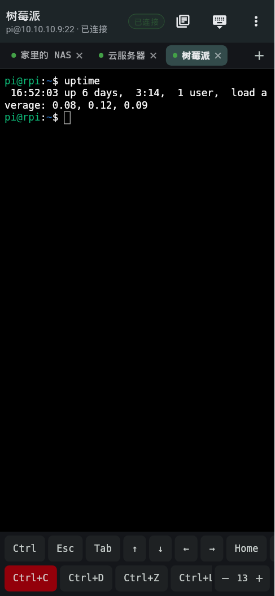
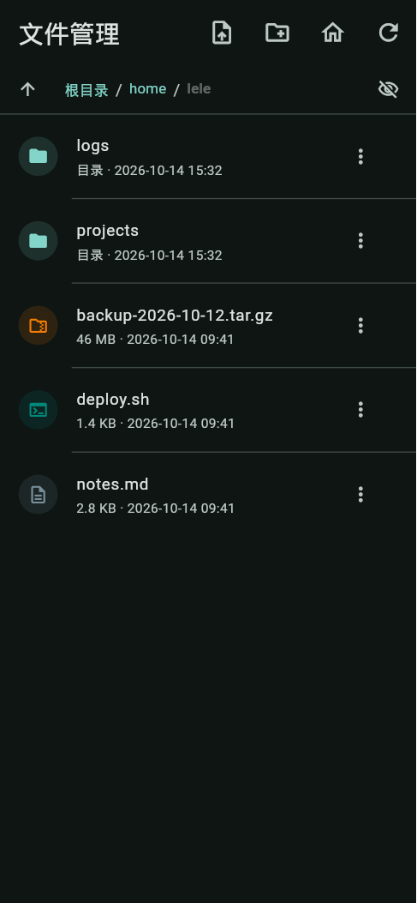
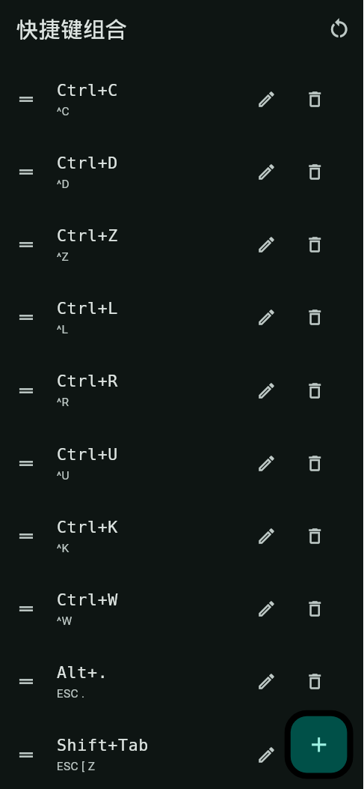
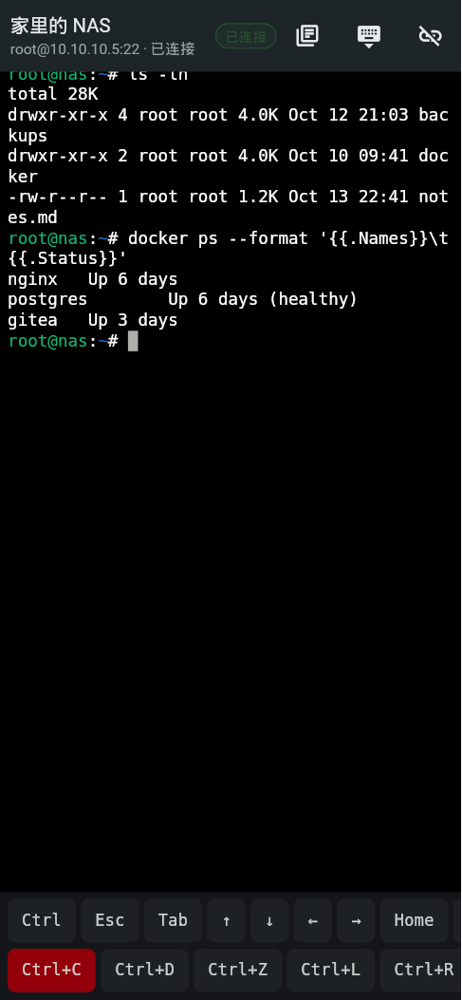
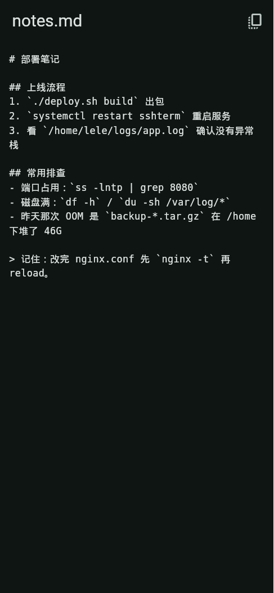
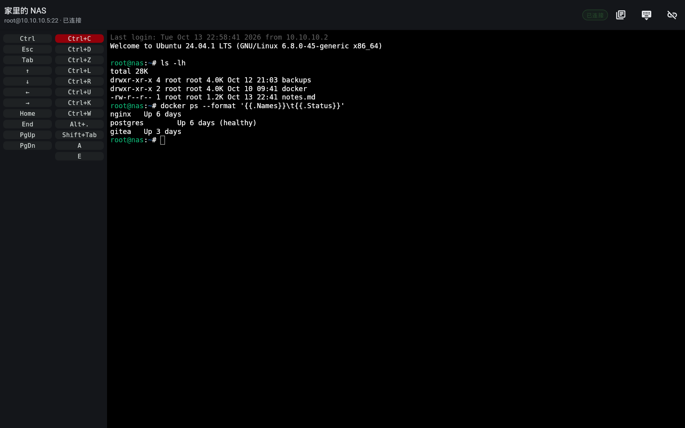

<div align="center">

# SSH 终端

**用 Flutter 自己撸一个能连 SSH 的手机终端**

纯 Dart：SSH 协议层用 `dartssh2`，终端仿真与渲染用 `xterm`。没有 WebView，没有原生终端库。

[](https://flutter.dev)
[](https://dart.dev)
[-3DDC84?logo=android&logoColor=white)](#)
[](#版本记录)
[](#测试)
[](LICENSE)

</div>

---

## 这是什么

一个 Android 上的 SSH 客户端。想解决的具体问题是「手机上敲命令到底难受在哪」：

- **软键盘抢屏** —— 一弹键盘就吃掉半屏，看不到输出。所以软键盘只在你要打字时才弹，其余时间让位给终端；常用的 Ctrl / Alt / Esc / Tab / 方向键做成一排快捷栏，不用切输入法。
- **开第二个连接就得退出去** —— 所以有了多标签，切走的会话在后台活着，远端跑的 `tail -f` 不会断。
- **改个配置文件还得再装个 FTP App** —— 所以 SFTP 直接内置，复用同一条 SSH 连接，不二次认证。
- **点来点去光标不动** —— 点终端上任意一列，光标就挪过去（这条踩了个库的坑，见下文）。

## 截图

| 终端 · 多标签 | SFTP 文件管理 | 快捷指令 |
| :---: | :---: | :---: |
|  |  |  |
| **夜间主题** | **文本文件预览** | **平板 / 横屏** |
|  |  |  |

> 全部 26 张界面图在 [`design/preview/`](design/preview)，由 `tool/preview_shot_test.dart` 在无头环境下渲染真实 widget 生成，不是手绘稿。

## 功能

**连接**
- 主机列表增删改，支持密码与私钥两种方式（私钥支持口令短语）
- 密码 / 私钥 / 口令全部存进 **Android Keystore**（`flutter_secure_storage`），不落明文
- 首次连接记住主机公钥指纹（TOFU），指纹变了会拦下来

**终端**
- 多标签会话，`IndexedStack` 保活 —— 切标签不重连、不丢缓冲、不丢滚动位置
- 点按终端任意一列，远端光标跟着挪（走方向键，不是视觉缩放）
- 字号 10–22 可调并持久化；改字号会重算行列数，**远端 PTY 的 `$COLUMNS/$LINES` 同步变化**
- 中文宽字符、输入法正常
- 夜间 / 日间两套主题

**SFTP**
- 面包屑导航、隐藏项折叠、按后缀识别图标
- 展示 POSIX 权限串（`-rw-r--r--`）、大小、修改时间
- 新建目录 / 重命名 / 删除
- 文本类文件内置预览页
- 下载走流式（几百兆的日志不会先攒进内存），上传从本机选文件
- 传输目录落在 `Android/data/<包名>/files/transfer`，**不需要任何存储权限**

**快捷输入**
- 自定义组合键与命令片段，一键发送
- 软键盘快捷栏：Ctrl / Alt / Esc / Tab / 方向键 / 分号 / 管道等，点击不弹输入法

**适配**
- 手机单列、平板双栏两套布局，横屏可用

## 下载

[**下载 v1.4.1 的 APK**](https://github.com/liujinle1995/sshterm/releases/download/v1.4.1/sshterm-1.4.1.apk) · 也可在 [Releases](../../releases) 页面找历史版本。

| | |
| --- | --- |
| 版本 | `1.4.1+6` |
| 大小 | 56.5 MB |
| SHA1 | `6def1144197d91a284d05c91a115bf02dd1aa36e` |
| ABI | `arm64-v8a` / `armeabi-v7a` / `x86_64` |

装之前不用卸旧版 —— 同一个签名，可直接覆盖安装。

## 技术栈

| 用途 | 选型 |
| --- | --- |
| SSH 协议 | [`dartssh2`](https://pub.dev/packages/dartssh2) — 纯 Dart，shell / PTY / SFTP 全有 |
| 终端仿真 | [`xterm`](https://pub.dev/packages/xterm) — VT100/xterm 序列解析 + 渲染 |
| 凭据存储 | `flutter_secure_storage` — Android 侧落 Keystore |
| 主机 / 设置持久化 | `shared_preferences` |
| 传输目录 | `path_provider` |

## 目录结构

```
lib/
├── models/        数据模型（主机、命令片段、组合键、远端条目）
├── services/      无 UI 的逻辑层
│   ├── terminal_session.dart   SSH 连接 + PTY + 复用同连接的 SFTP
│   ├── remote_fs.dart          SFTP 抽象接口
│   ├── sftp_fs.dart            真实实现（包 SftpClient）
│   ├── demo_fs.dart            内存实现，供预览与测试注入
│   ├── remote_path.dart        远端 POSIX 路径处理
│   └── credential_store.dart   凭据 / 主机指纹
├── theme/         主题与配色
└── ui/            页面（终端工作区、SFTP、主机管理、设置、外观、更新记录…）
assets/
├── changelog.json  更新记录（应用内读取）
└── plugins.json    插件清单
design/preview/     界面预览图
tool/               build_icon.py、key_icon.py、preview_shot_test.dart
test/               109 个测试
```

## 开发

需要 Flutter 3.47+ 与 JDK 17。

```bash
git clone https://github.com/liujinle1995/sshterm.git && cd sshterm

# 国内网络加这两行可以少等很久
export PUB_HOSTED_URL=https://pub.flutter-io.cn
export FLUTTER_STORAGE_BASE_URL=https://storage.flutter-io.cn

flutter pub get
flutter run
```

出 release 包：

```bash
flutter build apk --release
# build/app/outputs/flutter-apk/app-release.apk
```

> `android/app/build.gradle.kts` 里的 release 目前用 debug 密钥签名（Flutter 模板默认行为），
> 要正式发布请自己加一份 keystore 配置，并把 `android/key.properties` 加进 `.gitignore`。

重新生成界面预览图：

```bash
SHOT=22 flutter test tool/preview_shot_test.dart   # 只出第 22 张
flutter test tool/preview_shot_test.dart            # 全出
```

**踩过的两个环境坑**（不是代码问题，纯环境）：

- 工程路径里带中文会让 `flutter analyze` 直接崩，先拷到纯 ASCII 路径再跑。
- JDK 17 的 C2 JIT 在 Gradle 构建中偶发 SIGSEGV，在 `~/.gradle/gradle.properties` 加一行 `-XX:TieredStopAtLevel=1` 可解。

## 测试

```bash
flutter test
```

109 个用例，覆盖路径工具、权限串格式化、SFTP 浏览 / 改动 / 传输 / 错误态、
多标签切换与焦点、字号持久化与上下限。

其中「点终端挪光标」那组走的是**真实指针事件**（`tester.tapAt` 喂像素坐标），
不是直接调内部方法 —— 这一点是血泪教训，详见版本记录里 v1.4.1 那条。

## 版本记录

完整记录在 [`assets/changelog.json`](assets/changelog.json)，应用内「设置 → 更新记录」读的就是它。

几个值得一提的节点：

- **v1.4.1** — 修掉「点终端光标不动」。根因是 `xterm 4.0.0` 的 `TerminalView.onTapUp`
  是个**只声明不兑现的参数**：手势识别器只接了 `onSingleTapUp`，而 `TerminalView` 从来没往下传过它，
  所以那个回调一次都不会被调用。上游最新版仍是 4.0.0，没有可升的修复，
  最终自己用 `Listener` 接一层原始指针事件绕开，像素 → 字符格子借 xterm 自己的 `getCellOffset`。
- **v1.4.0** — 多标签会话、SFTP 文件管理、终端字号缩放。
- **v1.3.0** — 平板 / 折叠屏 / 横屏适配。
- **v1.2.0** — 触摸移动光标、快捷指令不弹软键盘。

## 许可

MIT
